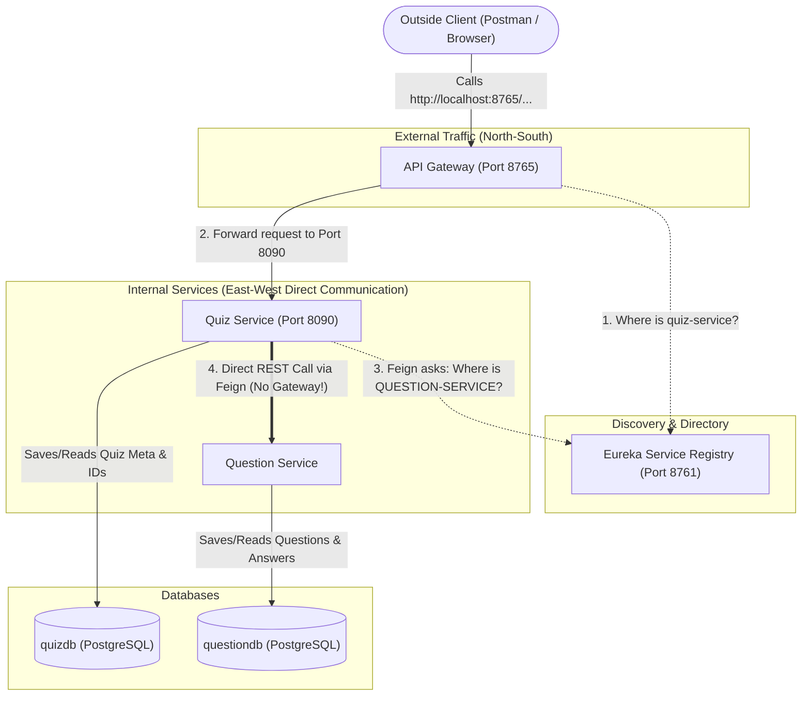
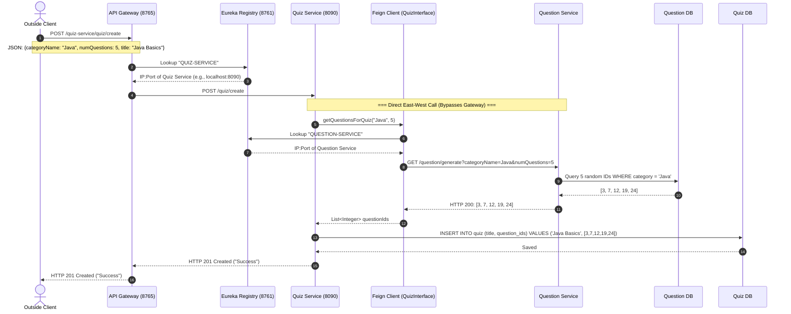
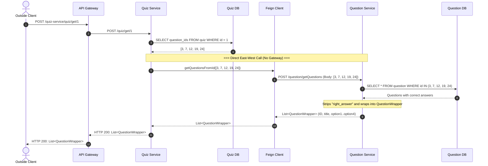
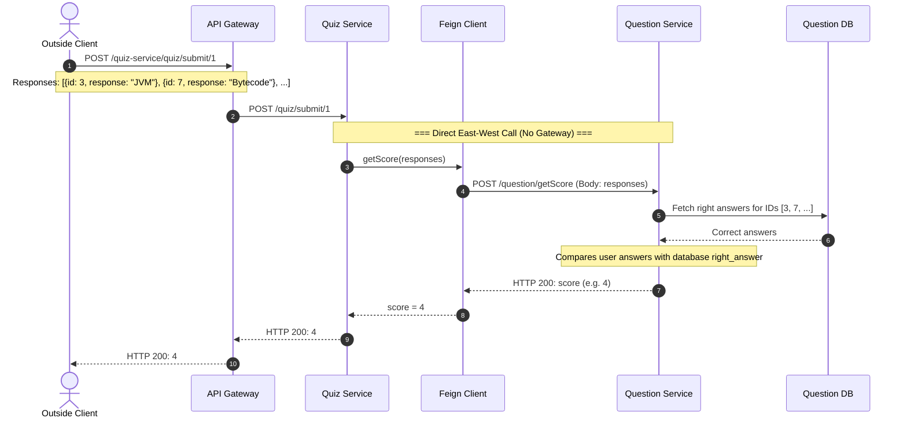

# Microservices Communication Workflow

This document explains the communication architecture and request workflows in the **Quiz-Question Microservices** project, clarifying the role of the **API Gateway**, **Eureka Service Registry**, and **Spring Cloud OpenFeign**.

---

## 1. Key Concept: North-South vs. East-West Traffic

In this architecture, there are two distinct types of network traffic:

| Traffic Type | Description | Path | Uses API Gateway? |
| :--- | :--- | :--- | :---: |
| **North-South Traffic** (External $\rightarrow$ Internal) | Outside clients (Browser, Postman, Mobile App) calling the system. | Client $\rightarrow$ **API Gateway** $\rightarrow$ Microservice | **YES** |
| **East-West Traffic** (Internal $\rightarrow$ Internal) | Microservices communicating directly with each other. | `quiz-service` $\rightarrow$ `question-service` | **NO** |

> [!IMPORTANT]
> **When `quiz-service` communicates with `question-service`, the API Gateway is NOT in the path.**
> `quiz-service` uses **Spring Cloud OpenFeign** and **Eureka** to establish a direct service-to-service connection.

---

## 2. High-Level Architecture Diagram



---

## 3. Detailed Workflows

### Workflow 1: Creating a Quiz (`POST /quiz/create`)

When an administrator or user requests the creation of a quiz:



---

### Workflow 2: Getting Quiz Questions to Play (`POST /quiz/get/{id}`)

When a student starts a quiz, the quiz questions must be shown **without** revealing the correct answers.



---

### Workflow 3: Submitting Answers and Getting the Score (`POST /quiz/submit/{id}`)

`quiz-service` does not know what the correct answers are. It delegates scoring to `question-service`.



---

## 4. Code Implementation Summary

### Feign Interface in Quiz Service (`quiz-service`)
File: `quiz-service/src/main/java/com/amine/quizservice/feign/QuizInterface.java`

```java
@FeignClient("QUESTION-SERVICE") // Eureka service ID resolved directly
public interface QuizInterface {

    @GetMapping("question/generate")
    public ResponseEntity<List<Integer>> getQuestionsForQuiz(
            @RequestParam String categoryName, 
            @RequestParam Integer numQuestions);

    @PostMapping("question/getQuestions")
    public ResponseEntity<List<QuestionWrapper>> getQuestionsFromId(
            @RequestBody List<Integer> questionIds);

    @PostMapping("question/getScore")
    public ResponseEntity<Integer> getScore(
            @RequestBody List<Response> responses);
}
```

### Destination Controller in Question Service (`question-service`)
File: `question-service/src/main/java/com/amine/questionservice/controller/QuestionController.java`

- `GET question/generate` $\rightarrow$ Generates random question IDs.
- `POST question/getQuestions` $\rightarrow$ Returns question objects without answers (`QuestionWrapper`).
- `POST question/getScore` $\rightarrow$ Compares submitted answers against correct answers and returns score.

---

## 5. Why the Gateway is Bypassed for Internal Calls

1. **Lower Latency**: Calling directly cuts out extra network hops and serialization through the gateway.
2. **Prevent Gateway Bottlenecks**: The gateway focuses on routing external traffic and rate-limiting. Flooding it with internal calls degrades overall system performance.
3. **Decentralized Load Balancing**: Feign uses Eureka's local cache on `quiz-service` to pick an available instance of `question-service` directly.

---

## 6. How to Run Locally

### Prerequisites
- **Java 17+** (JDK 17 or 21)
- **Maven 3.8+**
- **PostgreSQL** running on `localhost:5432` with databases `quizdb` and `questiondb`.

### Database Setup
1. Create the databases:
   ```sql
   CREATE DATABASE quizdb;
   CREATE DATABASE questiondb;
   ```
2. Populate seed data into `questiondb`:
   ```bash
   psql -U postgres -d questiondb -f question-table-data.sql
   ```

### Startup Order
Start each microservice in its own terminal:

1. **Service Registry** (Eureka - Port `8761`):
   ```bash
   cd service-registry && mvn spring-boot:run
   ```
2. **Question Service** (Port `8080`):
   ```bash
   cd question-service && mvn spring-boot:run
   ```
3. **Quiz Service** (Port `8090`):
   ```bash
   cd quiz-service && mvn spring-boot:run
   ```
4. **API Gateway** (Port `8765`):
   ```bash
   cd api-gateway && mvn spring-boot:run
   ```

Open `http://localhost:8761` in your browser to verify all microservices are registered in Eureka.

---

## 7. Testing APIs with Postman & cURL

A ready-to-import Postman collection is included in the project: [`postman_collection.json`](postman_collection.json).

### Quick cURL Examples (Via API Gateway: Port 8765)

**1. Create a Quiz:**
```bash
curl -X POST http://localhost:8765/quiz-service/quiz/create \
  -H "Content-Type: application/json" \
  -d '{"categoryName": "Java", "numQuestions": 5, "title": "Java Fundamentals"}'
```

**2. Fetch Questions for Quiz #1 (Fair play: No answers exposed):**
```bash
curl -X POST http://localhost:8765/quiz-service/quiz/get/1
```

**3. Submit Quiz Answers and Calculate Score:**
```bash
curl -X POST http://localhost:8765/quiz-service/quiz/submit/1 \
  -H "Content-Type: application/json" \
  -d '[{"id": 1, "response": "Bytecode"}, {"id": 2, "response": "Java"}]'
```
